# Feedforward Compensation for DC Motor Current Control
 
A study of **feedforward compensation** combined with a PI feedback controller in a DC motor current-control loop, with MATLAB/Simulink simulations for two use cases:
 
| Type | Goal | Simulation |
|------|------|------------|
| **Type 1** | Improve **reference tracking** at frequencies above the PI bandwidth | `example_1` |
| **Type 2** | Reject **input disturbances** acting on the plant | `example_2` |
 
Full derivations, figures and discussion are in the report (see [Reports](#reports)).
 
## Reports
 
| File | Language | Authorship |
|------|----------|------------|
| [`docs/report_feedforward.pdf`](docs/report_feedforward.pdf) | Vietnamese | **Original report, written by the author.** |
| [`docs/report_feedforward_ver_english.pdf`](docs/report_feedforward_ver_english.pdf) | English | **AI-generated:** translated from the Vietnamese original using ChatGPT. |
 
> The Vietnamese report is the authoritative version. The English version is provided for convenience; if the two differ, refer to the Vietnamese original.
 
---
 
## Table of Contents
 
- [Reports](#reports)
- [Background](#background)
- [Repository Structure](#repository-structure)
- [Requirements](#requirements)
- [Type 1: Reference Tracking](#type-1-reference-tracking-example_1)
- [Type 2: Disturbance Compensation](#type-2-disturbance-compensation-example_2)
- [Comparison of the Two Methods](#comparison-of-the-two-methods)
- [Key Takeaways](#key-takeaways)
- [Author](#author)
---
 
## Background
 
A feedback controller reacts to the error between the reference and the measured output. Feedforward instead computes in advance the signal needed to achieve the desired response, using knowledge of the reference or the disturbance. The two are added:
 
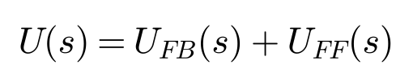
 
Feedforward does not replace feedback. Feedback handles model error and unknown disturbances; feedforward handles known effects without waiting for an error to appear.
 
---
 
## Repository Structure
 
> Adjust this section to match your actual folder layout.
 
```
.
├── README.md
├── docs/
│   ├── report_feedforward.pdf               # Report (Vietnamese) - written by the author
│   └── report_feedforward_ver_english.pdf   # Report (English) - AI-generated (ChatGPT) translation
├── simulation/
│   ├── example_1.slx                        # Type 1: reference-tracking feedforward
│   └── example_2.slx                        # Type 2: disturbance-compensation feedforward
└── images/                                  # Equation images used in this README
```
 
## Requirements
 
- MATLAB with Simulink (version: _fill in the version you used_)
- Control System Toolbox (if your scripts use `tf`, `bode`, etc.)
**Run:** open `example_1` or `example_2` in Simulink, run the model, and view the `I_meas` vs `I_cmd` scope.
 
---
 
## Type 1: Reference Tracking (`example_1`)
 
### Plant and controller
 
DC motor armature circuit with R = 0.6 Ω and L = 1.5 mH:
 
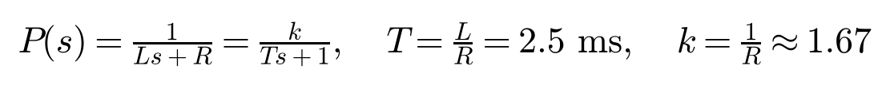
 
PI controller, with the zero chosen to cancel the plant pole:
 
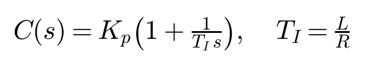
 
The closed loop then becomes a first-order lag. For a 1 kHz bandwidth: K<sub>p</sub> = 9.42 and T<sub>I</sub> = 0.0025.
 
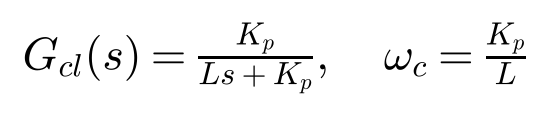
 
### Problem without feedforward
 
For a sinusoidal reference above the bandwidth, feedback alone gives amplitude attenuation and phase lag:
 
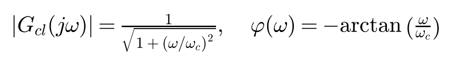
 
### Feedforward design
 
With the feedforward path F<sub>FF</sub> acting in parallel with the controller, the tracking error is:
 
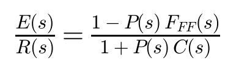
 
The error vanishes when 1 − P(s)·F<sub>FF</sub>(s) = 0, so the ideal choice is:
 
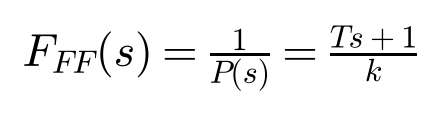
 
This is **non-causal** (numerator order higher than denominator), so a second-order Butterworth low-pass filter Q(s) is added:
 
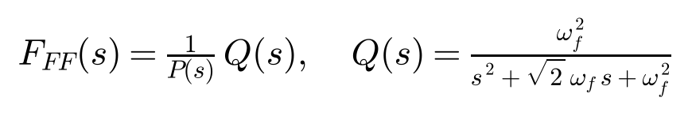
 
The cutoff ω<sub>f</sub> must be high enough to avoid attenuation and phase lag at the frequency being compensated, but low enough to avoid amplifying noise and below half the sampling frequency.
 
### Simulation setup
 
| Parameter | Value |
|-----------|-------|
| Reference | r(t) = 4 + 0.5·sin(4000πt) (2 kHz component) |
| PI bandwidth | 1 kHz (K<sub>p</sub> = 9.42, T<sub>I</sub> = 0.0025) |
| Filter cutoff f<sub>f</sub> | 20 kHz |
| Sampling frequency | 100 kHz |
 
### Results
 
| Case | Amplitude ratio (output / reference) | Phase lag |
|------|--------------------------------------|-----------|
| Feedback only | 45.9 % | ≈ 63° |
| Feedback + feedforward | ≈ 1.0976 | ≈ 11.8° |
 
Feedforward greatly improves high-frequency tracking. The slight amplitude overshoot (≈ 1.0976) shows that filter and feedforward parameters must be tuned carefully.
 
---
 
## Type 2: Disturbance Compensation (`example_2`)
 
### System model
 
The loop includes the power converter P<sub>b</sub>(s) between the controller and the motor. The converter is modeled on the **ESCON Module 50/5 (438725)** with switching frequency 53.6 kHz, as a first-order lag:
 
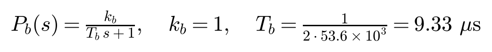
 
The disturbance d enters at the plant input:
 
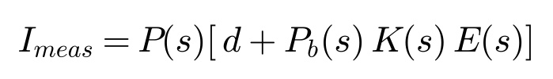
 
### Feedforward design
 
To cancel the disturbance, the compensator must satisfy the condition below, which gives the ideal feedforward:
 
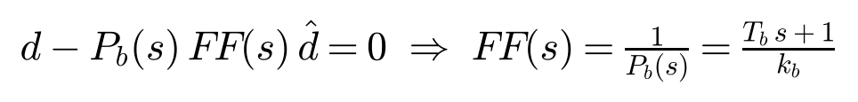
 
Again non-causal, so the same Butterworth filter Q(s) is applied. Because of the filter, compensation is no longer perfect at all frequencies.
 
### Controller recalculation
 
With T<sub>I</sub> = L/R = 0.0025 cancelling the motor pole, the open loop is:
 
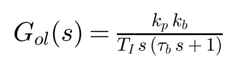
 
Setting |G<sub>ol</sub>(jω<sub>BW</sub>)| = 1 gives:
 
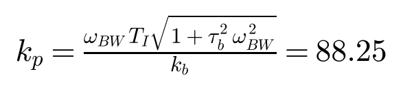
 
### Simulation setup
 
| Parameter | Value |
|-----------|-------|
| Sampling frequency f<sub>s</sub> | 53.6 kHz (= converter switching frequency) |
| PI bandwidth f<sub>BW</sub> | f<sub>s</sub> / 10 = 5.36 kHz |
| Current reference | I<sub>cmd</sub> = 1 A |
| Disturbance | d = 40 V |
| Feedforward filter cutoff | 1×, 2×, 3×, 4×, 5× ω<sub>BW</sub> |
 
### Results
 
| Case | Peak (A) | Overshoot (%) | Undershoot (%) | Rise time (s) |
|------|----------|---------------|----------------|---------------|
| No FF | 1.0000 | 0 | 13.006 | 5.0326 × 10<sup>−3</sup> |
| FF: 1 × ω<sub>BW</sub> | 1.0236 | 2.3568 | 10.011 | 4.9383 × 10<sup>−5</sup> |
| FF: 2 × ω<sub>BW</sub> | 1.1174 | 11.742 | 8.2484 | 3.4507 × 10<sup>−5</sup> |
| FF: 3 × ω<sub>BW</sub> | 1.1405 | 14.054 | 7.1422 | 3.1651 × 10<sup>−5</sup> |
| FF: 4 × ω<sub>BW</sub> | 1.1540 | 15.401 | 6.4225 | 3.0161 × 10<sup>−5</sup> |
| FF: 5 × ω<sub>BW</sub> | 1.1579 | 15.794 | 5.925 | 2.9306 × 10<sup>−5</sup> |
 
**Observations**
 
- Adding feedforward cuts rise time from about 5 ms to about 49 µs (at 1 × ω<sub>BW</sub>) and reduces undershoot from 13.0 % to 10.0 %.
- Increasing the filter bandwidth from 1× to 5× ω<sub>BW</sub> speeds up the response (rise time down to about 29 µs) and reduces undershoot (down to 5.9 %), but overshoot grows from 2.4 % to 15.8 %.
- Among the tested cases, 1 × ω<sub>BW</sub> has the lowest overshoot and 5 × ω<sub>BW</sub> the fastest response, a clear speed-versus-overshoot trade-off.
---
 
## Comparison of the Two Methods
 
| Criterion | Type 1 | Type 2 |
|-----------|--------|--------|
| Objective | Improve reference tracking | Reduce the effect of disturbances |
| Feedforward input | Reference R(s) | Disturbance D(s) |
| Principle | Compensate the closed-loop dynamics | Generate a signal that counteracts the disturbance |
| Ideal transfer function | 1 / P(s) | 1 / P<sub>b</sub>(s) |
| Implementation | 2nd-order Butterworth LPF | 2nd-order Butterworth LPF |
| Result | Less amplitude attenuation and phase lag | Less undershoot and shorter response time |
 
---
 
## Key Takeaways
 
1. Feedforward complements feedback; it does not replace it.
2. It serves two purposes: improving reference tracking and compensating disturbances.
3. Design relies on a plant model; the more accurate the model, the better the compensation.
4. The ideal feedforward is generally non-causal, so a low-pass filter is needed for implementation.
5. The filter bandwidth balances compensation at the target frequency against high-frequency noise amplification.
Feedforward is especially useful in electric drive systems where fast reference tracking and disturbance rejection are required without relying solely on the speed of the feedback loop.
 
---
 
## Author
 
**Bach**, Control Engineering and Automation, Hanoi University of Science and Technology (Bach Khoa Hanoi).
Focus: electrical drives and power electronics.
 
## License
 
_Choose a license (e.g. MIT) and add a `LICENSE` file, or remove this section._
 
